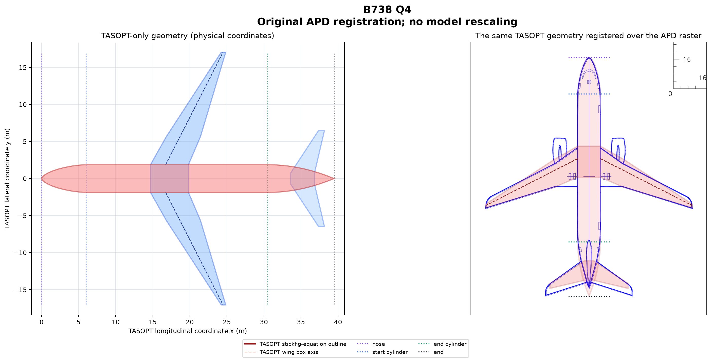
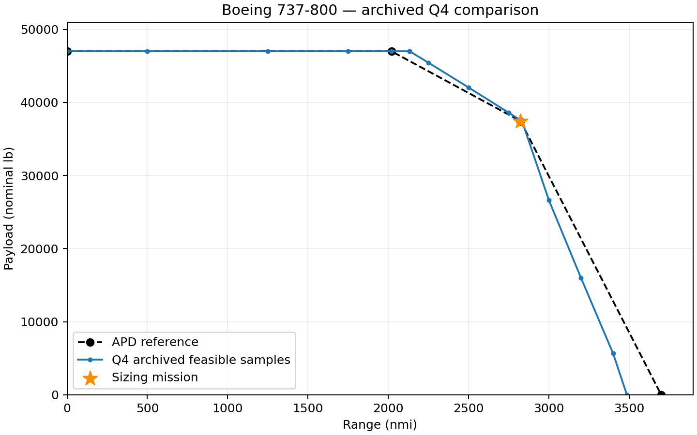
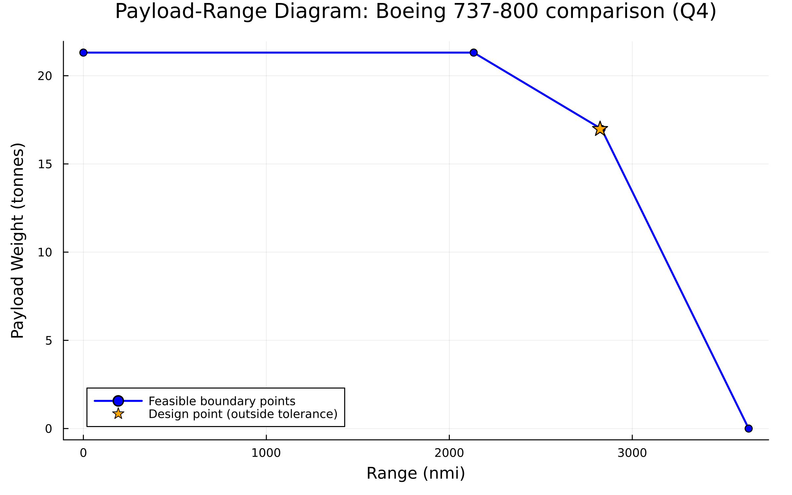

# Narrow body: Boeing 737-800

[Overview](Validation.md) · [Model](../defaults/default_narrow.toml)

**Archived Q4 comparison, 21 October 2026.** Results below come from the selected source study, not a replay with this branch’s altitude-grid function. This is a numerical comparison; formal validation, EDB and landing checks remain pending.

## Source documents

Airport planning document (APD): [Boeing 737NG, Revision C](https://www.boeing.com/content/dam/boeing/v2/airports/acaps/737NG_REV_C.pdf), archived PDF pages 65 (payload range), 25 (weights), and 304 (geometry). The selected 737-800 branch has MTOW 174,200 lb, maximum payload 47,000 lb and table fuel capacity 46,062 lb; the diagram rounds fuel to 46,063 lb. Winglets are excluded.

Engine Emissions Databank (EDB): [ICAO databank hosted by EASA](https://www.easa.europa.eu/en/domains/environment/icao-aircraft-engine-emissions-databank), archived v32, UID **01P11CM122**, CFM56-7B27E/B1. The APD/model context names CFM56-7B27-B1; the engine suffixes differ, so this is not established as an exact engine match. The current EASA download may differ from the archived version.

## Geometry comparison

| Metric | APD / source | Q4 model | Comment |
|---|---:|---:|---|
| Span (m) | 34.316 | 34.114 | Main wing, no winglets |
| Fuselage length (m) | 39.4716 | 39.4716 | Fixed input |
| Fuselage diameter (m) | 3.7592 | 3.7592 | Fixed input |
| Wing area (m²) | Definition unresolved | 115.740 | Do not mix exposed and reference areas |
| Wing-box station (m) | Not independently established | 16.751 | Forward location is a calibration tradeoff |
| Horizontal-tail area (m²) | Not independently established | 27.910 | Model result |

The overlay retains physical scaling. Geometry agreement does not establish structural or aerodynamic equivalence.

## Payload range validation

| Point | APD range (nmi) | Model range (nmi) | Range error (%) | APD payload (lb) | Model payload (lb) | Payload error (%) |
|---|---:|---:|---:|---:|---:|---:|
| 0: intercept | 0 | 0 | — | 47000 | 47000 | 0.000 |
| 1: maximum payload | 2020 | 2133.212 | +5.605 | 47000 | 47000 | 0.000 |
| 2: full fuel | 2824 | 2833.052 | +0.321 | 37446 | 37445.639 | -0.001 |
| 3: ferry | 3700 | 3486.253 | -5.777 | 0 | 0 | — |

Point 0 is a graphical intercept; maximum payload was verified at 500 nmi. The design mission is 2824 nmi at 37446 lb. It is distinct from the computed full-fuel corner. [Corner records](data/narrow/range_limits.csv) and [sampled curve](data/narrow/payload_range.csv) retain full precision.

This study searches starting altitude over 20,000–41,000 ft with local refinement and cruise climb enabled. Retained points pass convergence, native MTOW, geometric fuel capacity, payload, field length, top-of-climb gradient, compressor exit temperature, trajectory ceiling, static margin and segment-distance checks. Raw MTOW and fuel limits have zero positive slack. Range brackets are retained in the data; finite search and interpolated lines are not a proof of a continuous global envelope.

Mach 0.80 and a reserve fraction of 0.249896959 replace APD long-range-cruise and explicit alternate/hold procedures. Calibration against these same corners makes their agreement a fit assessment, not independent validation. The current plotting function’s 28,000–50,000-ft grid and constraints can produce different corner ranges.

## Secondary metrics

| Metric | Reference | Q4 model | Error (%) |
|---|---:|---:|---:|
| MTOW (lb) | 174200 | 174842.5 | +0.369 |
| Empty-weight proxy (lb) | 91300 | 91374.6 | +0.082 |
| MZFW proxy (lb) | 138300 | 138374.6 | +0.054 |
| Fuel capacity (lb) | 46062 | 46022.2 | -0.086 |
| EDB rated thrust (kN/engine) | 121.4 | Not evaluated | — |
| EDB takeoff flow (kg/s/engine) | 1.293 | Not evaluated | — |
| EDB climbout flow (kg/s/engine) | 1.031 | Not evaluated | — |
| EDB approach flow (kg/s/engine) | 0.343 | Not evaluated | — |
| EDB idle flow (kg/s/engine) | 0.110 | Not evaluated | — |

Historical nominal-lbf convention is N/4.448222. Empty weight is MTOW minus design fuel and payload; MZFW adds maximum payload to that proxy. Mission landing weight is not maximum landing-weight capability. EDB evidence did not guide the Q4 fit.

## Optimization

### Objective function

Minimize `J = sum(w[m] * Wfuel[m]) / ((1 + reserve_fraction) * 9.81)`, the mission-weighted burned fuel excluding reserves. The source SLSQP run reached relative FTOL `1e-6` after 575 evaluations; Q4 objective **4994.782 kg**. This is a local result. APD residuals were outside the inner fuel objective; calibration assumptions were frozen during each fuel solve.

| Mission | Range (nmi) | Payload (lb) | Weight |
|---|---:|---:|---:|
| Design | 2824 | 37446 | 0.0022 |
| Off-design 1 | 500 | 37446 | 0.3947 |
| Off-design 2 | 750 | 37446 | 0.3922 |
| Off-design 3 | 1250 | 37446 | 0.1373 |
| Off-design 4 | 1750 | 37446 | 0.0551 |
| Off-design 5 | 2250 | 37446 | 0.0182 |

The source weights sum to 0.9997 and are retained without renormalizing. The reserve, payload-related fixed-weight fraction, tank-box width, tail volume/downwash and nacelle assumptions were calibrated externally; they are not measured aircraft properties.

### Optimized design variables

| Variable | Selected value | Lower bound | Upper bound |
|---|---:|---:|---:|
| `Wing.AR` | 10.054876539724354 | 7 | 12 |
| `Wing.root_thickness_to_chord` | 0.14857416984187505 | 0.1 | 0.15 |
| `Wing.spanbreak_thickness_to_chord` | 0.1245898384150095 | 0.1 | 0.15 |
| `Wing.Aero.Climb.cls_clo` | 1.0719678637988748 | 0.8 | 1.5 |
| `Wing.Aero.Climb.clt_clo` | 1.2499313236731824 | 0.3 | 1.5 |
| `Mission.Cruise.cruise_CL` | [0.617650559166314, 0.57, 0.57, 0.57, 0.57, 0.57] | 0.45 | 0.65 |
| `Propulsion.Tt4_cruise` | 1497.4460312865513 | 700 | 2000 |
| `Propulsion.Tt4_takeoff` | 1738.6838930930944 | 1100 | 2000 |
| `Propulsion.Turbomachinery.Fan_PR` | 1.6797342426830466 | 1 | 3 |
| `Propulsion.Turbomachinery.LPC_PR` | 2.52790288608047 | 1 | 3.5 |
| `Propulsion.Turbomachinery.BPR` | 6.017562511323092 | 1 | 12 |
| `Wing.inner_panel_taper_ratio` | 0.899988197988935 | 0.5 | 0.9 |
| `Wing.outer_panel_taper_ratio` | 0.12000119613269199 | 0.12 | 0.4 |
| `Mission.Cruise.cruise_alt[1]` | 35164.76818626018 ft | 20000 | 41000 |
| `Mission.Cruise.cruise_alt[2]` | 38438.84031781344 ft | 20000 | 41000 |
| `Mission.Cruise.cruise_alt[3]` | 38125.67521444753 ft | 20000 | 41000 |
| `Mission.Cruise.cruise_alt[4]` | 37295.54574643297 ft | 20000 | 41000 |
| `Mission.Cruise.cruise_alt[5]` | 36305.21679908788 ft | 20000 | 41000 |
| `Mission.Cruise.cruise_alt[6]` | 35310.2539145141 ft | 20000 | 41000 |

Altitude bounds are in feet and turbine inlet temperatures in kelvin. HPC PR = 5 × LPC PR; OPR = 5 × LPC PR². Both taper ratios reference root chord. [Original optimization definition](data/narrow/optimization_problem.json).

### Constraints

The source problem limits span to 112.583 ft, fan diameter to 2 m, BFL to 7000 ft, top-of-climb gradient to at least 0.015, compressor exit temperature to 950 K and minimum static margin to 0.05, with native sized MTOW and geometric fuel capacity. Original BFL/climb relative allowances were `1e-5`; endpoint scaled acceptance was `1e-6`. Envelope evaluations additionally checked the 41,000-ft trajectory ceiling. These historical tolerances are distinct from the current plotting policy.

The imported TOML carries fan diameter 2 m, compressor exit 950 K and turbine metal 1280 K. Metal temperature was not an original inner optimization constraint; the current plotting function checks it. EDB/landing validation and the source study’s wing-area definition ambiguity remain unresolved.

## Current plotting-function check

The imported model also sizes successfully on this branch. A fresh run of [generate_plots.jl](generate_plots.jl) with the default 28,000–50,000-ft grid gives corner ranges **2133.105, 2831.972 and 3636.057 nmi**, with payloads **21311.563, 16979.257 and 0 kg**. The longer ferry range than the archived study uses a different altitude/constraint policy and is not a like-for-like validation improvement.

All solved boundary points pass the current `1e-6` scaled tolerance. The saved design point does not: BFL is 2133.6113 m against 2133.6 m (scaled residual `5.29969e-6`); climb gradient is 0.014999864 against 0.015 (scaled residual `9.06564e-6`). Its orange marker retains that distinction. [Current numerical record](data/narrow/current_runtime.toml).
