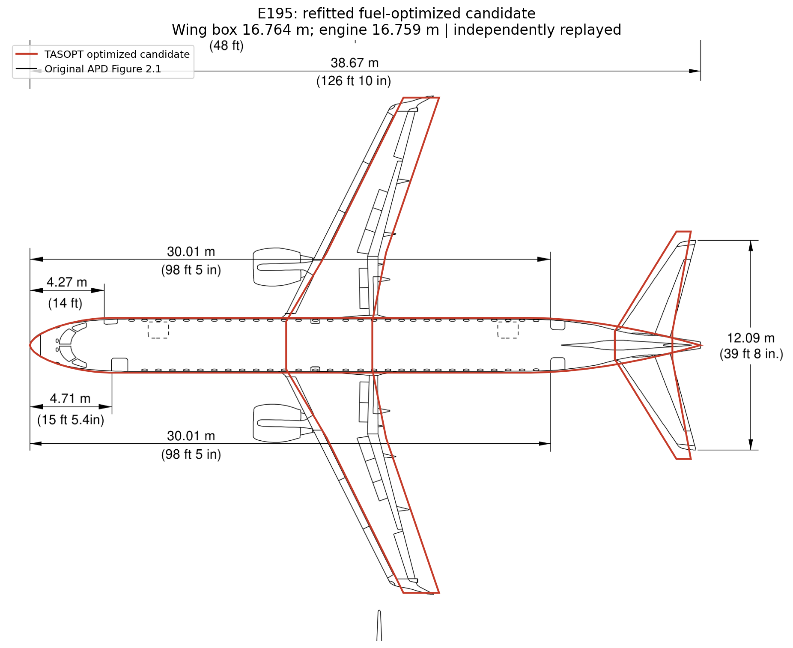
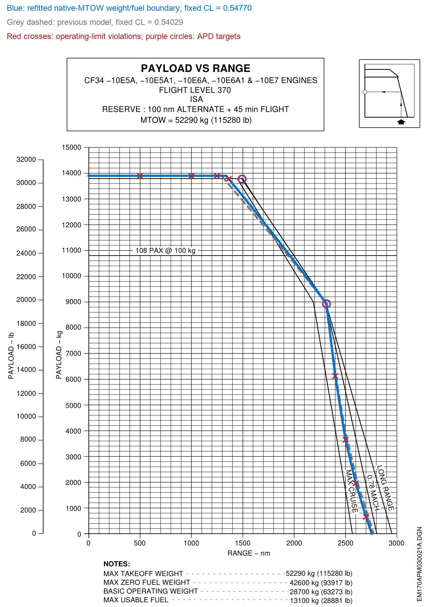
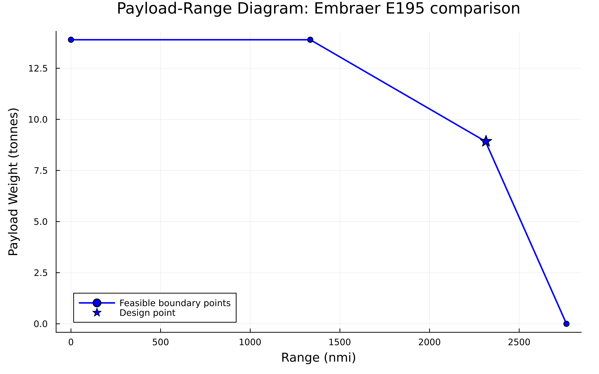

# Regional jet: Embraer E195

[Overview](Validation.md) · [Model](../defaults/default_regional.toml)

**Archived comparison, 21 October 2026.** Results and plots below use the source study’s runtime and fixed-CL envelope method, not the current altitude-grid function.

Status: original 17-DV fuel search completed (FTOL_REACHED, 171 evaluations), followed by independent reconstruction. This is a numerical model comparison, not a fully validated release.

Weighted fuel: **2770.419 kg**. Fresh replay difference: 0.00000000 kg. Nominal maximum scaled constraint residual: 1.71e-11.

## Source documents

Airport planning document (APD): [Embraer E195 APD](https://www.embraercommercialaviation.com/download/51/apm/3583/apm_e195.pdf)

Engine Emissions Databank (EDB): [EASA / ICAO databank](https://www.easa.europa.eu/en/domains/environment/icao-aircraft-engine-emissions-databank). CF34-10E7 is the selected model engine; the source study did not report a frozen-row EDB comparison. EDB thrust/fuel-flow errors therefore remain unassessed. The APD is APM-1997 Revision 21 (29 November 2024), PDF page 41, Figure 3.5, E195 AR / ERJ 195-200 IGW, FL370; its listed engine family includes several CF34-10E variants. The projected span below excludes winglets.

## Geometry comparison

| Metric | APD | Model | Error |
|---|---:|---:|---:|
| Wing area (m2) | 92.500 | 91.307 | -1.29% |
| Projected main-wing span (m) | 27.349 | 27.195 | -0.56% |
| Fuselage length (m) | 38.650 | 38.650 | 0.00% |
| Horizontal-tail area (m2) | 26.000 | 27.807 | +6.95% |
| Horizontal-tail span (m) | 12.080 | 12.490 | +3.39% |
| Vertical-tail area (m2) | 16.200 | 16.564 | +2.25% |

The projected main-wing trace is distinct from the APD span over winglets. The archived metric table uses a 38.65-m fuselage reference; the reproduced APD sketch labels 38.67 m (a 0.02-m discrepancy retained here). Geometry is plotted at physical scale with the existing APD registration, without model-dependent rescaling.

## Payload range validation

Fixed optimized cruise CL = 0.54769707; TASOPT calculates altitude and retains cruise climb. Native model MTOW and geometric fuel capacity are used. This does not reproduce constant APD FL370 or its alternate-plus-hold reserve calculation.

| APD range / payload | Previous range at APD payload | New range | Range error | Previous payload at APD range | New payload | Payload error |
|---|---:|---:|---:|---:|---:|---:|
| 1493 nmi / 13772 kg | 1319.34 nmi | 1363.96 nmi | -129.04 nmi (-8.64%) | 12959.53 kg | 13141.96 kg | -630.04 kg (-4.57%) |
| 2315 nmi / 8927 kg | 2308.11 nmi | 2314.94 nmi | -0.06 nmi (0.00%) | 8737.63 kg | 8927.05 kg | +0.05 kg (+0.00%) |

Actual constraint-transition corners:

| Model bend | Range nmi | Payload kg |
|---|---:|---:|
| Structural-payload / MTOW | 1338.57 | 13895.14 |
| MTOW / full fuel | 2315.53 | 8923.74 |

The two inverse boundaries are solved independently to 0.2 kg and 0.2 nmi, with zero positive weight/fuel feasibility allowance. Reported values are bracket midpoints; the earlier baseline used a 1 N allowance (about 0.10 kg). The traced first target is not silently substituted for the distinct structural-payload corner. Full-fuel and structural transition coordinates are in verification.toml.

At the first target payload, the CL-controlled weight/fuel boundary has top-of-climb gradient **0.014868**, versus the original **0.015** requirement (scaled shortfall **0.88%**). The payload-at-range and range-at-payload operating checks are recorded separately in payload_range_operating_audit.csv.

Operating audit: 8 of 18 sampled/endpoint states violate an operating limit. Red crosses retain those points visibly; the complete weight/fuel curve must not be called an operationally accepted envelope.

## Secondary metrics

| Metric | Source | Source kg | Previous kg | TASOPT kg | Error |
|---|---|---:|---:|---:|---:|
| MTOW | APD | 52290 | 50755.63 | 52065.09 | -0.43% |
| BOW / empty proxy | APD | 28700 | 28574.70 | 29408.91 | +2.47% |
| MZFW proxy | APD | 42600 | 42469.84 | 43304.05 | +1.65% |
| Usable fuel capacity | APD | 13100 | 13211.87 | 13732.44 | +4.83% |

MLW capability is unavailable; mission landing weight is not substituted.

The archived v32 EDB has three CF34-10E7 combustor variants. No variant was frozen by the source study, so the following references are retained separately; no fuel-flow error is claimed.

| EDB UID | Combustor | Rated thrust (kN) | Takeoff | Climbout | Approach | Idle |
|---|---|---:|---:|---:|---:|---:|
| 10GE133 | 2253M21 | 83.7 | 0.866 | 0.714 | 0.237 | 0.087 |
| 11GE146 | 2253M21-PFN | 83.7 | 0.870 | 0.717 | 0.239 | 0.088 |
| 8GE119 | SAC | 83.7 | 0.871 | 0.720 | 0.244 | 0.088 |

Flows are kg/s per engine at 100%, 85%, 30% and 7% rated thrust. The source study reports model static thrust **92.757 kN/engine**, 10.82% above 83.7 kN; this does not establish an exact combustor match. Model LTO flows were not evaluated in that study.

## Optimization

### Objective function

Minimize the original mission-weighted burned fuel: `J = sum(weight[m] * fuel_burned_kg[m])`.

Calibration inputs were frozen within each fuel solve. The active set remained wing sweep, two thickness ratios, clean spanwise lift ratios, cruise CL, cruise/takeoff Tt4, fan PR, LPC PR, BPR and six cruise altitudes. The original OPR linkage, bounds, objective weights and constraints were retained. No efficiencies or excrescence were added as DVs. APD residuals did not enter the inner fuel objective.

The Design Mission remains 2315 nmi at 8927 kg payload, Mach 0.78. Mission ranges are 2315/500/750/1250/1750/2250 nmi. Objective weights are 0/0.777475463381376/0.19997145982971032/0.0211006992341721/0.0014523775547416321/0. Fuel objective excludes the modeled reserve.

### Optimized design variables

| DV | Value | Unit | Lower bound | Upper bound |
|---|---:|---|---:|---:|
| wing_sweep | 24.486495 | deg | 10.0 | 40.0 |
| root_thickness_to_chord | 0.14498502 | dimensionless | 0.1 | 0.15 |
| spanbreak_thickness_to_chord | 0.13262626 | dimensionless | 0.1 | 0.15 |
| clean_rcls | 1.2924678 | dimensionless | 0.8 | 1.5 |
| clean_rclt | 0.75214001 | dimensionless | 0.3 | 1.5 |
| clean_lift_coefficient | 0.54769707 | dimensionless | 0.45 | 0.65 |
| cruise_turbine_inlet_temperature | 1435.971 | K | 700.0 | 2000.0 |
| takeoff_turbine_inlet_temperature | 1702.101 | K | 1100.0 | 2000.0 |
| fan_pressure_ratio | 1.7447033 | dimensionless | 1.0 | 3.0 |
| core_lpc_pressure_ratio | 4.6822119 | dimensionless | 1.0 | 5.0 |
| bypass_ratio | 5.3595248 | dimensionless | 1.0 | 12.0 |
| cruise_altitude_m1 | 35428.844 | ft | 20000.0 | 60000.0 |
| cruise_altitude_m2 | 39719.641 | ft | 20000.0 | 60000.0 |
| cruise_altitude_m3 | 39235.045 | ft | 20000.0 | 60000.0 |
| cruise_altitude_m4 | 38024.07 | ft | 20000.0 | 60000.0 |
| cruise_altitude_m5 | 35455.909 | ft | 20000.0 | 60000.0 |
| cruise_altitude_m6 | 34612.581 | ft | 20000.0 | 60000.0 |

HPC PR = 1.3518578513793105 × LPC PR; OPR = 1.3518578513793105 × LPC PR². The [archived optimization definition](data/regional/optimization_definition.toml) preserves bounds, weights and tolerances.

The imported model makes inherited template inputs explicit; see [provenance](data/model_provenance.toml).

### Constraints

Nominal checks include original takeoff/climb and engine limits, geometric fuel and native MTOW, wing area within 2%, fixed wing/engine stations, minimum static margin 0.15, forward-CG tail CL at least -0.6, and 41000-ft ceiling. The existing trim limit is now checked during the search as well as independent replay.

## Verification and limitations

Wing-box station: 16.764000 m. Engine station: 16.759000 m. Static margin: 0.37567 (minimum 0.15). Required forward-CG tail CL: -0.59437.

EDB and APD landing evidence did not guide selection. This corner-fitting study does not establish a new protected-evidence release. The previous E195_5Sep.toml is preserved.

Source SHA256: `12494a52f8f7af068187ccccb29a836df0ce4cd5a0adf0dbbc370febdf16a563`. Numerical result: `outputs/experiments/e195_corner_trim_safe_20261021/outer5_bounded_fit_original17_result.toml`.

Archived [numerical verification](data/regional/verification.toml), [curve](data/regional/payload_range.csv), and [operating audit](data/regional/payload_range_operating_audit.csv) retain the underlying values. No zero-payload APD ferry reference was established in this study, so a ferry percent error is unavailable.

The imported TOML supplies fan diameter ≤2 m, compressor exit temperature ≤900 K and turbine metal temperature ≤1250 K for current constraint checks. These do not implement the source study’s entire optimization policy (including its trajectory ceiling and trim checks).

## Current plotting-function check

The imported model sizes successfully. The current 28,000–50,000-ft altitude grid gives corner ranges **1334.552, 2311.760 and 2763.651 nmi**, at **13895.139, 8923.743 and 0 kg** payload. All solved boundary points and the saved sizing mission pass the current `1e-6` scaled constraint tolerance. [Current numerical record](data/regional/current_runtime.toml).

The grid does not include the exact optimized design altitude (35428.844 ft), so the feasible design point can lie slightly beyond the grid-derived polygon. These four constrained points do not rehabilitate the archived fixed-CL curve’s operating violations; the two methods and sampled states differ.
