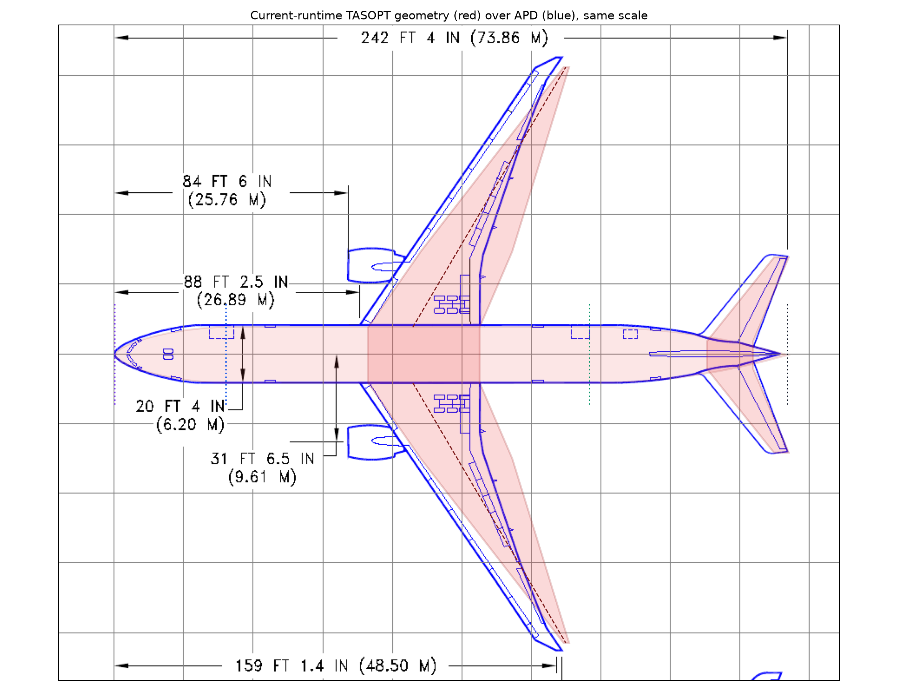
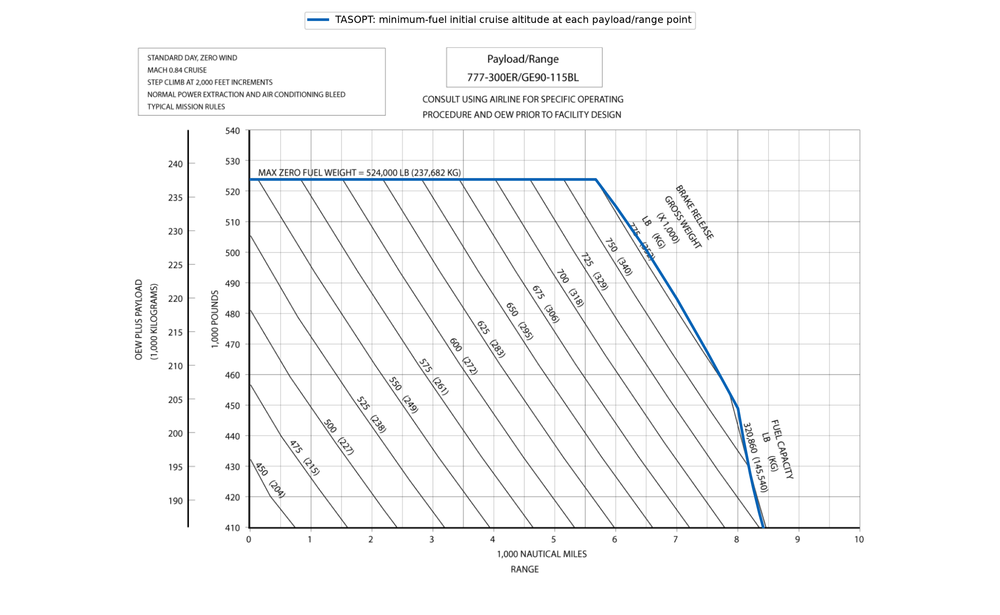
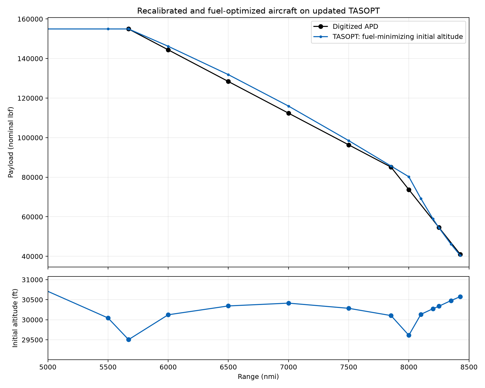
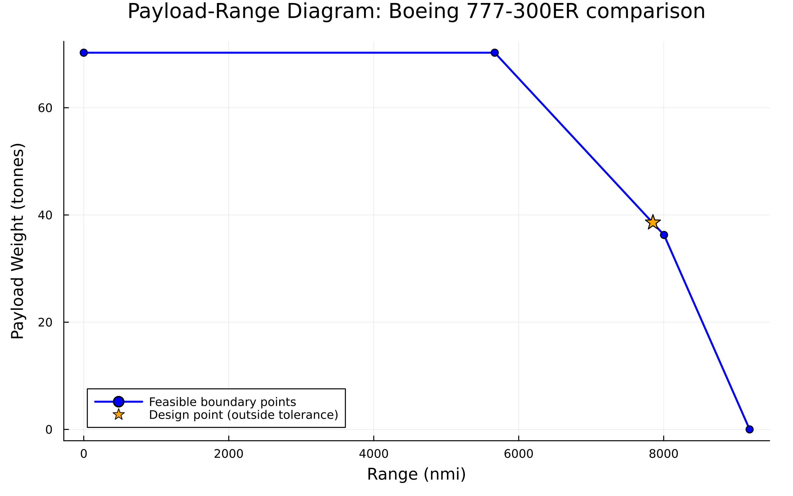

# Wide body: Boeing 777-300ER

[Overview](Validation.md) · [Model](../defaults/default_wide.toml)

**Archived comparison, 21 October 2026.** All results below belong to the source study and its recorded runtime, not a replay on this branch.

Calibration inputs were selected using fixed-DV sizing responses, then all 19 declared design variables were fuel-optimized. Source-study TASOPT commit: **458ac5a1**, with local changes captured in the runtime snapshot. Sizing and all six missions converge; the original declared physical checks **PASS**. The fuel search reached **FTOL 1e-6 on this runtime**; its best feasible incumbent was replayed independently. This is a fuel-optimized result within the declared local search scope; FTOL does not establish global optimality.

[Verified input TOML](../defaults/default_wide.toml) · Runtime/source receipt (source-study archive; not bundled) · [Numerical replay](data/wide/verification.toml) · Input changes (source-study archive; not bundled)

## Source documents

**Airport planning document (ADP/APD):** [Boeing 777-200LR / 777-300ER / 777F Airport Planning, Revision G](https://www.boeing.com/content/dam/boeing/v2/airports/acaps/777-200LR-300ER-F_Rev_G.pdf). This study uses the 777-300ER column, geometry sketch on PDF page 18, and the GE90-115BL payload-range diagram on PDF page 44 (775,000-lb branch).

**Engine Emissions databank (EDB):** [ICAO Aircraft Engine Emissions Databank, hosted by EASA](https://www.easa.europa.eu/en/domains/environment/icao-aircraft-engine-emissions-databank). Comparison uses the archived v32 workbook, GE90-115B UID **07P27GE240**, gaseous-emissions sheet. The public page may offer a later version; the archived study row is retained. EDB checks were performed only after this model was frozen and did not select or tune it.

## Geometry comparison

Red is the freshly sized fuselage, wing and horizontal tail; blue is the APD sketch. Registration uses the APD nose and 73.8632-m fuselage length, with the same scale in both directions. Engine and gear silhouettes are not rendered. Wing area is sketch-derived (±25 m²); horizontal-tail span uncertainty is ±0.60 m.

## Payload range validation

At **every trial (payload, range)**, the evaluator minimizes burned fuel over **initial cruise altitude 20,000–60,000 ft**, with the aircraft fixed. A 5,000-ft grid plus the saved design altitude identifies local minima; each detected basin is refined to a 5-ft altitude interval, with nearby ±25-ft checks. This is a bounded numerical search, not proof of a global optimum. TASOPT retains continuous cruise climb and recomputes CL for the selected initial altitude; this is not constant-altitude flight.

The outer payload/range boundary then checks native sized MTOW, geometric fuel capacity and maximum structural payload using the lowest-fuel converged altitude found. Each trial starts from a pristine sized aircraft. Failed missions/engine solves are excluded from the altitude search and are not treated as known physical boundaries. Payload brackets resolve to 0.1 lbf, range brackets to 0.001 nmi, with zero force slack.

| APD corner | APD range (nmi) | APD payload (lbf) | Model max payload at APD range (lbf) | Payload error (lbf) | Payload error (%) | Model max range at APD payload (nmi) | Range error (nmi) | Range error (%) |
|---|---:|---:|---:|---:|---:|---:|---:|---:|
| Maximum payload | 5670.782 | 154,960 | 154,960.000 | +0.000 | +0.00000% | 5671.363 | +0.581 | +0.01024% |
| Economy / sizing mission | 7852.000 | 85,100 | 85,647.354 | +547.354 | +0.64319% | 7866.885 | +14.885 | +0.18957% |
| Last digitized point | 8427.984 | 40,960 | 40,377.407 | -582.593 | -1.42235% | 8419.791 | -8.193 | -0.09721% |

The two model columns are separate inverse solves, not a single common point. The economy point is inherited as the sizing mission; altitude minimization in the envelope may improve its range relative to that fixed design mission. Its agreement is not independent validation.

Across the nine digitized APD stations, original-ordinate RMSE is **2,780 lbf** and payload-only RMSE is **2,893 lbf**. These correlated/interpolated points are calibration comparisons. The original APD ordinate uses model empty weight plus payload; no vertical shift is applied.

| Range (nmi) | Payload (lbf) | Fuel-minimizing initial altitude (ft) | End-of-cruise altitude (ft) | Cruise CL |
|---|---:|---:|---:|---:|
| 5500.000 | 154,960.0 | 30,045.0 | 37,345.8 | 0.47594 |
| 5670.782 | 154,960.0 | 29,505.4 | 37,080.6 | 0.47000 |
| 5671.363 | 154,960.0 | 29,505.4 | 37,081.4 | 0.47002 |
| 6000.000 | 146,206.4 | 30,124.1 | 38,035.9 | 0.48300 |
| 6500.000 | 131,865.4 | 30,344.4 | 38,869.7 | 0.48777 |
| 7000.000 | 115,966.8 | 30,414.7 | 39,621.0 | 0.48929 |
| 7500.000 | 98,508.1 | 30,285.4 | 40,247.3 | 0.48647 |
| 7852.000 | 85,647.4 | 30,104.1 | 40,631.3 | 0.48257 |
| 8000.000 | 80,233.2 | 29,612.8 | 40,434.8 | 0.47229 |
| 8100.000 | 69,206.6 | 30,134.9 | 41,082.8 | 0.47658 |
| 8200.000 | 59,012.0 | 30,274.6 | 41,387.4 | 0.47322 |
| 8250.000 | 54,429.7 | 30,337.8 | 41,528.6 | 0.47170 |
| 8350.000 | 46,152.3 | 30,477.4 | 41,812.7 | 0.46945 |
| 8427.984 | 40,377.4 | 30,577.9 | 42,019.8 | 0.46793 |

Sampled-curve diagnostics: **0 points** exceed one or more checked BFL/TOC/Tt3/end-altitude limits; full per-point values are in [payload_range.csv](data/wide/payload_range.csv). Altitude selection minimizes fuel, not APD error. These extra checks are diagnostics, so this remains a weight/fuel envelope rather than an accepted operational envelope.

APD 2,000-ft step climbs and alternate/hold reserves are not reproduced exactly. The model retains Mach 0.84 and a reserve fraction of 3%.

Independent altitude audit: **PASS** at all 19 retained curve/corner states. A separate 1,000-ft grid plus ±5-ft probes found a maximum fuel improvement of 0 kg over the selected altitudes (acceptance 0.1 kg total fuel). Fresh saved-altitude evaluations reproduced fuel within 0.001 kg. Audit receipt (source-study archive; not bundled).

## Secondary metrics

Error = 100 × (model/source − 1). Nominal-lbf convention: 4.448222 N/lbf; model gravity 9.81 m/s².

| Metric | Source | Source value | Source-study TASOPT | Error (%) |
|---|---|---:|---:|---:|
| MTOW / BRGW (lbf) | APD | 775,000.00000 | 775,421.06165 | +0.054% |
| Empty-weight proxy (lbf) | APD-derived | 369,040.00000 | 368,864.94174 | -0.047% |
| MZFW proxy (lbf) | APD | 524,000.00000 | 523,824.94174 | -0.033% |
| Usable fuel capacity (lbf) | APD-derived | 320,863.00000 | 326,565.08367 | +1.777% |
| Span (m) | APD | 64.80000 | 63.20508 | -2.461% |
| Wing area (m²) | APD sketch | 436.80000 | 475.79841 | +8.928% |
| Fuselage length (m) | APD | 73.86320 | 73.86320 | -0.000% |
| HT span (m) | APD sketch | 21.88800 | 21.43535 | -2.068% |
| Rated thrust (kN/engine) | EDB | 513.94762 | 433.65043 | -15.624% |
| Fuel flow takeoff (100% thrust; kg/s/engine) | EDB | 4.59414 | 3.96868 | -13.614% |
| Fuel flow climbout (85% thrust; kg/s/engine) | EDB | 3.56159 | 3.15515 | -11.412% |
| Fuel flow approach (30% thrust; kg/s/engine) | EDB | 1.06869 | 1.04152 | -2.542% |
| Fuel flow idle (7% thrust; kg/s/engine) | EDB | 0.33931 | 0.37351 | +10.079% |
| Maximum taxi capability (lbf) | APD | 777,000 | Not predicted | — |
| MLW capability (lbf) | APD | 554,000 | Not predicted | — |

The empty reference is inferred from MZFW minus maximum payload, not directly published OEW. Model empty = MTOW − design fuel − design payload; MZFW is a correlated proxy. Mission landing weight is not MLW. EDB uses equal relative thrust settings of differently rated engines, not matched absolute thrust. All four independent LTO solves converge. No emissions indices were evaluated, and EDB did not tune inputs.

## Optimization

### Objective function

$$J=\sum_m w_m\,m_{\mathrm{fuel,burned},m}=\frac{\sum_m w_m W_{\mathrm{fuel},m}}{(1+0.03)\,9.81}$$

Source-study replay: **J = 51,665.120401 kg**. The 19-DV optimization reached FTOL 1e-6 on the updated runtime after 240 optimizer evaluations. The returned point had maximum scaled constraint residual 1.41845971e-06, above the 1e-8 acceptance limit, so the best feasible incumbent was selected instead; its weighted fuel is 0.080563 kg higher. The fresh replay passes the declared physical constraints. The payload-range altitude minimizations are separate per-point analyses, not a replacement for the six-mission aircraft optimization.

| Mission | Range (nmi) | Payload (lbf) | Weight |
|---|---:|---:|---:|
| 1 | 7852 | 85,100 | 0 |
| 2 | 750 | 85,100 | 0.271570739232 |
| 3 | 2250 | 85,100 | 0.235126466189 |
| 4 | 3750 | 85,100 | 0.213809694017 |
| 5 | 5250 | 85,100 | 0.203136022876 |
| 6 | 6750 | 85,100 | 0.0763570776857 |

All missions retain Mach 0.84. The design mission has zero objective weight but still sizes and constrains the aircraft. Calibration inputs were fixed during fuel optimization: additional payload-weight fraction 0.614582367; wing-box width/chord 0.408738028; HT downwash 0.513320765.

### Optimized design variables

These values were selected by fuel optimization on the updated runtime and held fixed during the independent replay. Per-point envelope altitude is optimized independently as described above.

| Design variable | Optimized value | Lower bound | Upper bound |
|---|---:|---:|---:|
| `Wing.AR` | 8.39616426 | 7 | 12 |
| `Mission.Cruise.cruise_alt[1]` | 30624.5738 | 20000 | 60000 |
| `Mission.Cruise.cruise_alt[2]` | 39318.2803 | 20000 | 60000 |
| `Mission.Cruise.cruise_alt[3]` | 37439.1883 | 20000 | 60000 |
| `Mission.Cruise.cruise_alt[4]` | 35530.0799 | 20000 | 60000 |
| `Mission.Cruise.cruise_alt[5]` | 33603.6548 | 20000 | 60000 |
| `Mission.Cruise.cruise_alt[6]` | 31469.2913 | 20000 | 60000 |
| `Mission.Cruise.cruise_CL` | 0.493679193 | 0.45 | 0.65 |
| `Wing.root_thickness_to_chord` | 0.136693681 | 0.1 | 0.15 |
| `Wing.spanbreak_thickness_to_chord` | 0.118678879 | 0.1 | 0.15 |
| `Wing.Aero.Climb.cls_clo` | 1.10221369 | 0.8 | 1.5 |
| `Wing.Aero.Climb.clt_clo` | 1.37571334 | 0.3 | 1.5 |
| `Propulsion.Tt4_cruise` | 1583.2472 | 700 | 2000 |
| `Propulsion.Tt4_takeoff` | 1826.21219 | 1100 | 2000 |
| `Propulsion.Turbomachinery.Fan_PR` | 1.67603697 | 1 | 3 |
| `Propulsion.Turbomachinery.LPC_PR` | 1.85528734 | 1 | 3.5 |
| `Propulsion.Turbomachinery.BPR` | 7.09633795 | 1 | 12 |
| `Wing.inner_panel_taper_ratio` | 0.820472081 | 0.35 | 0.85 |
| `Wing.outer_panel_taper_ratio` | 0.0500021811 | 0.05 | 0.4 |

Cruise altitudes are initial altitudes in feet; Tt4 values are kelvin. OPR = 12 × LPC PR² and HPC PR = 12 × LPC PR. Both taper ratios reference root chord. The local COBYLA run uses relative FTOL 1e-6, zero absolute FTOL, and the unchanged bounds listed above.

### Constraints

Span ≤64.8 m; fan diameter ≤3.5 m; FPR ≤ LPC PR. Each of six missions: takeoff weight ≤ native sized MTOW, fuel ≤ geometric capacity, BFL ≤3,048 m, TOC gradient ≥.015, and Tt3 ≤950 K. Native minimum static margin remains .15; root and spanbreak t/c lower bounds are .10. Spar-box x/c remains .4. No trailing-edge constraints or APD matching constraints were added. BFL/TOC use 1e-5 relative allowances; scaled acceptance is 1e-8.

Fresh mission checks: **PASS**, maximum scaled residual **0**. [All 33 residuals](data/wide/physical_constraints.csv). APD residuals and EDB checks are not part of the inner fuel objective.

The runtime update includes the engine bending-relief moment-arm correction. Current source files and dirty modifications are captured in runtime_snapshot and runtime_diff.patch. Model input SHA-256: `181a229bef51ebb39bcba689edb7b127e00a4a0f6fc8a6220b72f88655003101`. Formal validated-aircraft release remains pending.

The final digitized APD station is not a zero-payload ferry corner. A ferry-range error cannot be inferred from that station. The current imported model additionally specifies turbine metal temperature ≤1350 K.

## Current plotting-function check

The imported model sizes successfully. The current 28,000–50,000-ft grid gives corner ranges **5669.375, 8004.880 and 9185.358 nmi**, at **70264.677, 36270.937 and 0 kg** payload. All solved boundary points pass the current `1e-6` scaled tolerance. Failed altitude trials were excluded; this finite grid is not a continuous global search. [Current numerical record](data/wide/current_runtime.toml).

The saved design mission is marked orange: its BFL is **3048.0243 m** against **3048 m**, a scaled residual of `7.98047e-6`. The source optimization allowed a `1e-5` relative BFL allowance, whereas the current plot checks the direct limit with `1e-6` scaled tolerance. The model was not modified to hide this difference. The computed full-fuel corner is separate from the 7852-nmi economy/sizing point and from the APD’s final digitized station.
